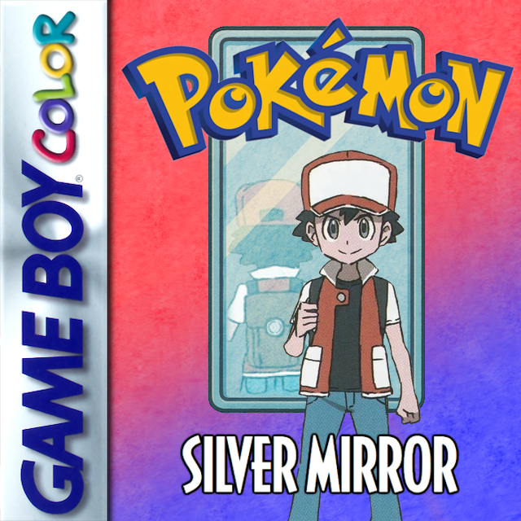

# Pokémon: Silver Mirror

This is a custom Pokémon game based on the Pokémon Crystal disassembly.  
Forked from Sour Crystal v4.1a  

My goal was to recreate the story of Red's journey through Kanto from Pokémon Red/Blue, with as many Quality of Life and graphical upgrades as possible while still maintaining the classic charm of the Gameboy/Gameboy Color Pokémon games.  
I also wanted to include a new post-game storyline in Johto, as a mirror to the inclusion of Kanto in Pokémon Gold, Silver, and Crystal.  Challenge the Johto Gym Leaders for eight more badges, and climb Mount Silver to face the final challenges in the game.

  

## Version 1.2.1 (Pending Release)  

Version 1.2.1 should be compatible with saves from v1.2.0.  
**I recommend making a backup of your save file anyway, just in case.**  
- <a href="https://github.com/Th3Element05/silvermirror/releases/tag/v1.2.1">Version v1.2.1 Release Page</a> (github)  
- [Available on HackDex](https://www.hackdex.app/hack/pokemon-silver-mirror)  

### __Version 1.2.1 Changelog:__  
- Fixed oversight causing Gen2/Alternate swarm to give shiny Pokémon set DVs instead of generating a random shiny DV.  
- Viridian Forest now shows the time of day instead of being always night like Ilex Forest.  

---

## Version 1.2.0 (Current Release)  

Version 1.2.0 is **NOT** compatible with previous save files.  
**Stay on version 1.1 if you want to continue your current save.**  
- <a href="https://github.com/Th3Element05/silvermirror/releases/tag/v1.2.0">Version v1.2.0 Release Page</a> (github)  
- [Available on HackDex](https://www.hackdex.app/hack/pokemon-silver-mirror)  

### __Version 1.2.0 Changelog:__  
- Added POTION in Player's PC at game start.  
- The PPS is now obtained in Pewter City, after defeating Brock.  
- Pokégear can now save 32 phone contacts.  
- Added INSTANT Text Speed setting.  

[**Full Changelog History**](CHANGELOG.md)

---

### __Resources:__
- **[Silver Mirror Discord Server](https://discord.gg/rsUamUSuwK)**
- **[Pokémon Silver Mirror Documentation](https://docs.google.com/spreadsheets/d/1-3RvOeC4Ymswg5hqdd7F-1gGs5bRkSTm28OCV8ipzhM)**

## __Features and Changes:__

- **Classic Mode or Alternate Gen2 Mode**  
  >• Can be set during a New Game.  
  >• Enjoy a Classic experience limited to the original 151 Pokémon (until you defeat the Elite Four).  
  >• Or choose to encounter a wider variety of Pokémon on your journey through Kanto.  
- **251 Pokémon obtainable**  
  >• Complete the Pokédex without trading, in both Classic Mode and Gen2 Mode.  
- **Physical/Special Split**  
  >• Enabled by default, can be toggled in game Options.  
  >• On Classic setting, Ghost-Type is now special, Dark and Dragon-Type are now Physical.  
- **More Move Info**  
  >• Move Info (Type, Power, Accuracy, etc.) is shown in battle, when learning a new move, and many more places that moves can be viewed.  
- **Intrinsic Field Moves**  
  >• Appropriate Pokémon can use field moves (once it has been obtained in the story) without knowing the attack for battle.  
- **Pokégear Pager System**  
  >• Allows use of obtained Field Moves without needing to keep an appropriate user in your party.  
- **Pokémon Swarms**  
  >• Announced on the radio. The active Swarm is visible on the Pokégear map.  
  >• Swarming Pokémon have an increased chance of being shiny.  
- **Reusable TMs**  
  >• Use TMs to teach moves as many times as you like.  
- **Updated Move List and Level-up Moves**  
  >• Removed many duplicate or outdated/low-use moves to make room for over 60 new moves from Generation 3 and 4.  
  >(For example, Tail Whip was removed and replaced with Leer because they do exactly the same thing.)  
  >• Pokemon Level-up Moves have been reworked to include the new moves, based primarily on Generation 4.  
- **Updated Move properties**  
  >• Base Power, Accuracy, Effects, etc.  
- **Added Gen4 Evolutions**  
  >• The following Pokémon have been **removed** to make room for new evolutions:  
  >`Pichu, Cleffa, Igglybuff, Togepi, Togetic, Porygon2, Tyrogue, Smoochum, Elekid, and Magby.`  
  >• The following evolutions have been **added**:  
  >`Yanmega, Honchkrow, Mismagius, Gliscor, Weavile, Mamoswine, Magnezone, Tangrowth, Leafeon, and Glaceon.`  
  >• Porygon's base-stats have been boosted to match Porygon2's.  
  >• Eggs from Hitmonlee, Hitmonchan, and Hitmontop can contain any Hitmon- species.  
  >(Hitmontop eggs are unobtainable in Classic Mode until after defeating the Elite Four.)  
  >• Nidoran eggs can contain either Nidoran♂ or Nidoran♀.
- **Location-based Evolutions** for appropraite Pokémon.  
  >• (Only available in Gen2 Mode, or after defeating the Elite Four.)  
- **Trade Evolutions obtainable without trading**  
  >• Use the required item on Pokémon to evolve them.  
  >(Linking Cord, King’s Rock, Metal Coat, etc.)  
- **Postgame Gym Leader Rematches**  
  >• Kanto Leaders can be rematched after defeating the Elite Four.  
  >• Johto Leaders can be rematched after obtaining 16 Badges.  
- **Move Reminder**  
  >• Re-teach Pokémon any of their Level-up Moves.  
- **Shininess and Gender decoupled from DVs**  
  >• Male and Female Pokémon have equal chance to have high DVs or be shiny.  
- **Upgraded trainer rematches**  
  >• Rematch trainer parties scale as you progress through the story.  
- **Modern Bill's PC Boxes**  
  >• Has a GUI like Generation 3. Saving not required to switch Boxes.  
- **New Custom Pokémon Sprites**  
  >• Front Sprites/Animations by Sour Apple.  
  >• Back Sprites based on work by MeroMero.  
  >• Many have been adjusted by myself.  
  >• Every Pokémon has a unique sprite in your party.  
- **Upgraded battle graphics**  
  >• More dynamic colors and attack animations for many moves.  
- **More Inventory Space**  
  >• Main Pack pocket has been expanded to hold 25 items.  
  >• Barry pocket has been added to reduce your main pocket from getting full.  
  >• Pokégear phone contact list can store 32 contacts.  
- **Improved Payouts from Game Corner Games**  
  >• Slots: Significantly increased payout amounts, and increased odds of lucky rolls.  
  >• Card Flip: Doubled payout amounts.  
- **Difficulty Setting**  
  >• There's a "Difficulty Curve" setting which has a **minor** effect on the stats of opposing trainers' Pokémon.  
  (It determines how much Stat Exp. opponents' Pokémon have. This effect scales up as you collect more Badges.)  
- **Almost all bugs from vanilla Pokémon Crystal have been fixed.**  
- **A couple Secrets and Easter Eggs**  
  >• Based on classic Gen1 rumors and glitches.  
  >(There is a small hint book in Oak's Lab that you can access after progressing the story.)  
- **Many other small goodies to find!**  

 

### __Recommended Emulators:__
[mGBA](https://mgba.io/),  [BGB](https://bgb.bircd.org/), [SameBoy](https://github.com/LIJI32/SameBoy)

## __Screenshots:__

 

## __Silver Mirror Credits:__

### __Coding:__
- **Textbox Nametag Code**  
  >Narishma-gb  
- **Dynamic Levels Code**  
  >Ardorin  
- **Type and Category GFX Code**  
  >Nayru62  
  >Rangi42  
- **Various ASM Assistance**  
  >Grate Oracle Lewot  
  >Narishma-gb  
  >Ranji42  
  >RaJa239  
  >pq  
  >SatoMew  
  >DarkShade  
  >tanu  
  >**Everyone on the PRET pokecrystal Discord who helped me along the way!**  

### __Graphics:__
- **SourApple**  
  >Pokémon Front Pics and Animations  
- **MeroMero**  
  >Provided the base for most Pokemon Back Pics  
- **Polished Crystal**  
- >Pokémon Graphics by various contributors:  
  >`GLACEON, GLISCOR, HONCHKROW, LEAFEON, MAGNEZONE, MAMOSWINE, MISMAGIUS, TANGROWTH, WEAVILE, and YANMEGA`  
  >Reef tile gfx  
  >Some tileset animation code  
- **SkidMarc25**  
  >Provided some trainer graphics for:  
  >`Player Backs, Misty, Sailor, Fisher, Cyclist, Rockets, Giovanni, Lorelei, and Lance`  

### __Audio:__
- **dannye** pokered-crysaudio  
  >Gen1 Music Tracks  

### __Testing:__
- **Alpha Version Testers**  
  >Exkzol  
  >Bleeperwagon  
- **Beta Version Testers**  
  >Exkzol  
  >Bleeperwagon  
  >Geometry13  
  >Greg  
  >Ssenrah  
  >TigerBlood  
  >Knight Owl  

 

## __Sour Crystal Credits:__

### __Codework:__
- **FIQ** for various ASM work, and  the dynamic battle palette system
- **Vulcandth** for various ASM work, and for porting the NEWBOX PC system
- **Rangi42** for various ASM work and being a huge inspiration
- **Zumi** for various ASM work and bugfixing
- **Pfero** for various ASM and bugfixing
- **Luna** for assisting with the Safari Zone code

### __Music:__
- **CoralDev** for the new Kanto trainer battle music
- **Mmmmmm** for various music covers
- **FroggestSpirit** for various music covers

 

## __Special Thanks:__
- Everyone who has contributed to disassembling Pokémon Crystal.  
- **Satoshi Tajiri**, **Game Freak**, and **Nintendo** for creating Pokémon Crystal in the first place.  

 

# Pokémon Silver Mirror [Build Info]

Silver Mirror is based on a disassembly of Pokémon Crystal.  
Specifically forked from Sour Crystal v4.1a.

To set up the repository, see [INSTALL.md](INSTALL.md).  
>uses RGBDS v0.6.0

Apply .bps patch to Base Rom: **Pokémon Crystal (Rev 1)**  
https://www.romhacking.net/patch/

I learned Assembly in the process of making this game.  
I don't actually know how to use git, and most of my commits are a mess.  

 

## __AI Information:__

On occasion, I asked ChatGPT to help *explain the function of some existing code*,  
because I was literally learning Assembly from scratch as I worked on this project.  
**AI was not used** to *write any code* or *generate any art* for this project.  

 

## See also

- [**pokecrystal FAQ**](FAQ.md)
- [**pokecrystal Documentation**][docs]
- [**pokecrystal Wiki**][wiki] (includes [tutorials][tutorials])

Other disassembly and/or decompilation projects:
* [**Pokémon Red and Blue**](https://github.com/pret/pokered)
* [**Pokémon Yellow**](https://github.com/pret/pokeyellow)
* [**Pokémon Gold and Silver**](https://github.com/pret/pokegold)
* [**Pokémon Crystal**](https://github.com/pret/pokecrystal)
* [**Pokémon Ruby and Sapphire**](https://github.com/pret/pokeruby)
* [**Pokémon Emerald**](https://github.com/pret/pokeemerald)
* [**Pokémon FireRed and LeafGreen**](https://github.com/pret/pokefirered)
* [**Pokémon Diamond and Pearl**](https://github.com/pret/pokediamond)
* [**Pokémon Platinum**](https://github.com/pret/pokeplatinum) 
* [**Pokémon HeartGold and SoulSilver**](https://github.com/pret/pokeheartgold)
* [**Pokémon Gold and Silver (Space World '97 demo)**](https://github.com/pret/pokegold-spaceworld)
* [**Pokémon Trading Card Game**](https://github.com/pret/poketcg)
* [**Pokémon Pinball**](https://github.com/pret/pokepinball)
* [**Pokémon Stadium**](https://github.com/pret/pokestadium)
* [**Pokémon Pinball: Ruby & Sapphire**](https://github.com/pret/pokepinballrs)
* [**Pokémon Mystery Dungeon: Red Rescue Team**](https://github.com/pret/pmd-red)
* [**Pokémon Mystery Dungeon: Explorers of Sky**](https://github.com/pret/pmd-sky)

## PRET Contacts

* [Discord (PRET, #pokecrystal)](https://discord.gg/d5dubZ3)
* [IRC](https://web.libera.chat/?#pret)

[docs]: https://pret.github.io/pokecrystal/
[wiki]: https://github.com/pret/pokecrystal/wiki
[tutorials]: https://github.com/pret/pokecrystal/wiki/Tutorials
[symbols]: https://github.com/pret/pokecrystal/tree/symbols
[ci]: https://github.com/pret/pokecrystal/actions
[ci-badge]: https://github.com/pret/pokecrystal/actions/workflows/main.yml/badge.svg
